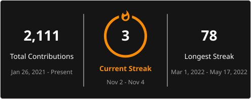

# Hey, I'm Aditya! 👋

### Frontend Engineer · React · Next.js · TypeScript

**I turn ideas into thoughtful digital experiences.**

I'm a frontend engineer passionate about building modern, scalable, and user-friendly web applications. I enjoy solving real-world problems, exploring new technologies, and turning complex ideas into simple, intuitive experiences.

I believe great software isn't just about how it works — it's also about how it feels to use.

- 💻 Building modern web applications with **React, Next.js & TypeScript**
- 🚀 Developing production-ready features used by thousands of users
- 🎨 Passionate about UI engineering, frontend architecture & performance
- 🧩 Love building useful products and developer tools
- 🌱 Always learning, experimenting, and building something new
- 🤝 Open to interesting projects, open-source collaboration, and meaningful conversations

  
  
  
  

---

## 🛠️ Tech Stack & Tools

Technologies and tools I use to bring ideas to life.

### Frontend Development

  

### State Management & APIs

  

**Also working with:** Zustand, REST APIs, Axios, Fetch API, tRPC, oRPC, React Hook Form.

### Tools & Workflow

  

**Also familiar with:** Jest, React Testing Library, Storybook, Turborepo, CI/CD, and modern frontend build tools.

---

## 🚀 Featured Projects

I enjoy turning everyday problems into useful software. Here are some products and tools I've built along the way.

### 🎯 [Focusy](https://github.com/adityackr/focusy)

**One place for learning and focus.**

Why switch between multiple applications when you can bring them together?

Focusy combines the experiences of Chapterly and FocusTube into one unified application, making video-based learning and focused productivity easier.

### 📚 [Chapterly](https://github.com/adityackr/chapterly)

**Turn YouTube videos into structured learning experiences.**

Paste a YouTube video link and transform it into chapter-based lessons using video timestamps. Learn at your own pace and navigate educational content more effectively.

### 📺 [FocusTube](https://github.com/adityackr/focustube)

**Watch what matters. Skip the distractions.**

A focused YouTube viewing experience designed to help you spend less time navigating distractions and more time watching the content you actually want.

### 🧵 [KettleStitch](https://github.com/adityackr/kettlestitch)

**Another idea brought to life.**

One of my independent projects, built as part of my journey of experimenting, learning, and creating useful software.

### 🧩 [Smart Wrapper](https://github.com/adityackr/smart-wrapper-vscode-extension)

**Small tool. Smoother coding workflow.**

A Visual Studio Code extension designed to make working with code wrappers easier and more convenient for developers.

  

---

## 📊 GitHub at a Glance

  
  

  

---

## 💡 A Little More About Me

Beyond writing code, I'm someone who enjoys learning, experimenting, and sharing ideas.

- 🧠 I enjoy exploring frontend architecture and software design patterns.
- 🔍 I love understanding how things work under the hood.
- 🛠️ I prefer building real products over just following tutorials.
- 🌍 I believe open-source software makes the developer community stronger.
- ☕ Always ready for a good technical discussion.

---

## 🤝 Let's Connect!

I'm always happy to connect with developers, designers, and people who love building things.

Whether it's discussing a technical idea, collaborating on an open-source project, or simply exchanging experiences, feel free to reach out.

  
  
  
  

  <b>Thanks for stopping by! Happy coding. 🚀</b>

